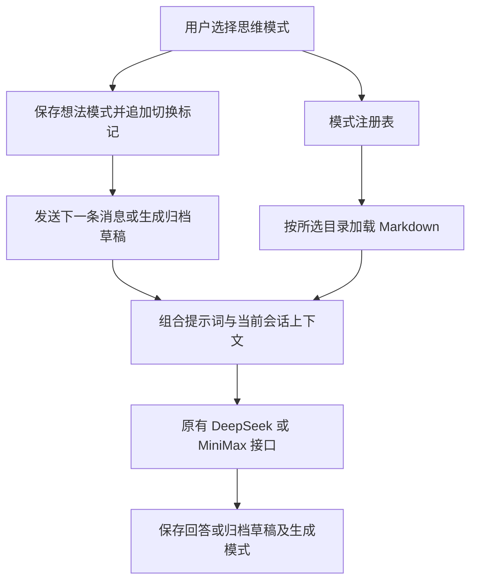

# 思维模式：设计与实现归档

归档日期：2026-11-27。本文记录第一版已实现的行为、实现依据、代码入口和扩展方法。

## 1. 目标与核心思路

让用户在同一条对话中选择一种分析问题的方法。人物名称作为入口，对应 skill 提供分析步骤、适用条件、参考资料和边界。第一版提供“默认”和“教员”，主要服务于现实问题的分析与行动建议。

教员模式结合实际情况、关键矛盾、行动和验证分析问题。回答应根据问题复杂度调整：简单问题直接回答，复杂问题展开分析，缺少关键事实时先追问。人物口吻不能改变事实，也不能把所有问题机械套入同一套标题。

实现的核心路径是：**模式选择 → 找到对应 skill → 加载 Markdown 资料 → 组装模型上下文 → 保存回答及其模式信息**。应用仍是 React、TypeScript 和 Vite 的纯前端程序，使用原有 DeepSeek／MiniMax 调用方式。

这里的“使用 skill”指将 skill 内容和参考资料提供给模型作为指令与分析依据。应用没有接入一个能执行工具、访问文件或自主检索资料的 agent 运行时。skill 中的链接用于说明出处；模型不能因此实际打开文件、执行命令或读取 EPUB。

## 2. 已确认的产品行为

| 决策 | 第一版行为 |
| --- | --- |
| 模式范围 | 每个想法独立选择和保存模式；新想法使用默认模式 |
| 回应方式 | 思维模式与静默／简洁／详细独立组合 |
| 切换时机 | 对话中可切换；请求进行中或本地保存暂停时禁用切换 |
| 切换结果 | 在时间线追加切换标记，不自动调用 AI |
| 后续回答 | 使用新模式，同时利用完整的已有讨论 |
| 历史回答 | 保留原文和当时的模式，不重新生成 |
| 事实约束 | 根据事实调整判断，允许指出框架不适用 |
| 资料解释 | 区分原著观点、现代应用、事实依据和 AI 推断 |
| 归档方案 | 使用生成时的模式，保留目标、决策、执行步骤和验收标准 |
| 过期草稿 | 新增讨论或切换模式后，必须重新生成才能确认归档 |
| 历史归档 | 后续切换不改变已确认版本的模式、正文和讨论快照 |
| 维护方式 | 维护者添加或修改 skill，用户在界面选择；首版不提供上传入口 |

静默模式不发送聊天请求，但用户主动生成归档草稿时，仍使用所选思维模式。简洁模式通常限制为 1–3 句，用户明确要求展开时允许详细回答；这项限制只作用于聊天，不限制归档方案。

## 3. 代码结构与职责

| 文件 | 职责 |
| --- | --- |
| [thinking-modes.ts](../src/thinking-modes.ts) | 模式注册表、模式类型、合法性检查和显示名称 |
| [thinking-skills.ts](../src/thinking-skills.ts) | 按需加载 Markdown 资料，生成模式指令和应用约定 |
| [types.ts](../src/types.ts) | 想法、消息、切换记录、草稿和版本中的模式字段 |
| [data.ts](../src/data.ts) | 默认值、切换记录、草稿过期判断、数据校验和导出恢复 |
| [ai.ts](../src/ai.ts) | 组合提示词与业务上下文，处理模型请求、取消和长度限制 |
| [App.tsx](../src/App.tsx) | 选择入口、持久保存、请求后的模式记录和归档联动 |
| [ConversationMessage.tsx](../src/components/ConversationMessage.tsx) | 在当前会话和历史快照中统一显示消息与切换标记 |
| [styles.css](../src/styles.css) | 两组模式选择与切换提示的桌面、窄屏样式 |



## 4. 模式注册与资料组织

`thinkingModes` 是模式元数据的唯一注册入口。目前包含：

| value | label | skill |
| --- | --- | --- |
| `default` | 默认 | `null` |
| `mao-selected-works` | 教员 | `mao-selected-works` |

每项还有用于界面说明的 `hint`。`ThinkingMode` 类型直接从注册表推导，合法性检查和显示名称查询也使用同一份注册表。

教员资料结构如下：

```text
skills/mao-selected-works/
├── SKILL.md
├── patterns.md
├── cheatsheet.md
├── glossary.md
└── chapters/
    ├── ch01-volume-one.md
    ├── ch02-volume-two.md
    ├── ch03-volume-three.md
    └── ch04-volume-four.md
```

主文件定义核心方法、适用范围和资料入口；方法库与速查表提供操作方式；术语表澄清概念；卷册参考文件补充具体文章分析、例子和局限。

### 加载方式

加载器使用 Vite 的 `import.meta.glob('../skills/**/*.md', { query: '?raw', import: 'default' })`，将构建时发现的 Markdown 转为可动态导入的文本模块。

请求到来时，根据注册项的 `skill` 目录筛选文件，排序后并行加载。每个文件附带相对路径标识，随后合并为模式资料。主文件不存在或为空、动态加载失败时明确报错，不静默退回默认模式。

“按需加载”的单位是**整个模式目录**。教员模式每次请求包含该目录中的全部 Markdown；默认模式不加载和发送教员资料。第一版没有按主题选择片段、向量检索或 RAG。模型在已经获得的完整资料中选择相关方法。

资料会作为构建产物分包交付。修改本地文件不会直接修改已部署站点；生产环境需要重新构建和部署。

## 5. 请求上下文如何生效

系统消息按以下顺序组合：

1. 应用原有的思考伙伴指令：澄清问题、区分事实与建议、沿唯一时间线讨论、由用户决定归档。
2. 当前模式指令、skill 正文和参考资料，以及应用约定。
3. 当前任务的输出要求：普通聊天或归档草稿。
4. 回应方式约束：聊天选择简洁时追加短回复要求。

默认模式有明确指令，要求灵活分析当前问题，避免继续扮演历史上选择过的人物或强制沿用其方法。

另一条用户消息是 JSON 业务上下文，包含以下字段：

| 字段 | 内容 |
| --- | --- |
| `action` | `chat` 或 `archive` |
| `idea_title` | 当前想法标题 |
| `thinking_mode` | 本次所选模式 |
| `latest_plan` | 最近归档版本当前编辑后的标题、正文和版本号；没有时为 `null` |
| `conversation` | 当前完整时间线，包含用户、助手和模式切换记录 |

消息上的 `thinking_mode` 表示当时的模式，`mode-change` 表示历史切换事件。系统指令明确这些信息只描述背景，不能覆盖本次选择。`mode-change` 位于 JSON 内容内部；它不是发送给服务商接口的新增聊天消息角色。接口外层仍是原有的 system 和 user 两条消息。

其它想法、旧版本快照和未发送输入不进入请求。密钥继续放在 `Authorization` 请求头中。

归档继续使用原有格式：DeepSeek 返回标题和 Markdown 两字段 JSON，MiniMax 返回带一级标题的 Markdown。切换模式不改变接口地址、模型配置或结果解析方式。

### 资料与事实边界

应用约定要求模型根据用户事实调整结论，解释方法不适用的情况，并区分原著观点、现代类比和自己的推断。呈现分析结论、依据与行动建议，不披露内部推理。

现有资料是 Markdown 方法总结与文章分析，未接入 EPUB 原著。准确引文、页码、完整原文论证和版本比较需要原著核对；模型不能把参考资料当作已经核验的原文，也不能根据仅有索引的篇目标题编造内容。

这些约定通过提示词引导模型，并不构成回答质量的确定性保证。

## 6. 数据模型、时间线与兼容

| 数据位置 | 字段与语义 |
| --- | --- |
| `Idea.thinkingMode` | 必填，表示该想法当前选择；新建为 `default` |
| 助手消息 `thinkingMode` | 可选，记录生成该回答时的模式；历史消息可以缺省 |
| 切换记录 | `role: 'mode-change'`，必须包含 `thinkingMode`，同时保存 ID、文本和时间 |
| `ArchiveDraft.thinkingMode` | 可选，保存生成草稿时的模式；新生成的草稿明确写入 |
| `PlanVersion.thinkingMode` | 可选，确认归档时从草稿继承模式 |

`changeThinkingMode()` 返回新的想法对象，更新模式与修改时间，并在消息末尾追加标记。重复选择当前模式不生成记录。原有消息与版本保留。

切换记录参与时间线和快照，但不计入界面中的消息条数。仅有切换记录时仍等待用户输入，不能单独生成归档。查找“最后一条待回复消息”时也跳过标记，避免切换后丢失继续或重试入口。

新生成的助手回答保存请求开始时的模式，而不是显示时再读取当前选择。当前会话和历史快照使用统一组件渲染，历史回答可显示“思考伙伴 · 教员”，切换标记以独立提示展示。

### 旧数据与备份

本地存储键和 JSON 备份格式继续使用版本 1。旧想法没有 `thinkingMode` 时，加载和恢复补为 `default`；旧草稿、版本和消息允许缺少模式信息，显示和判断按默认模式处理。

恢复会校验模式值、消息角色和模式字段组合，拒绝未知模式以及缺少模式的切换记录。有效对象重新构建，额外字段不会直接进入状态。合并备份时先规范化比较，避免仅因补充默认值产生恢复副本。

Markdown 方案导出包含归档模式；选择附带讨论时同时导出切换标记和助手回答的模式。JSON 备份保留当前选择、切换记录、回答模式、归档模式、草稿和未发送输入。

这里的兼容方向是新实现读取旧数据。旧应用版本可能无法读取带有新消息角色的备份。

## 7. 草稿过期与归档联动

`archiveDraftIsStale()` 在以下任一条件成立时判定草稿过期：

1. 草稿生成模式与当前模式不同，缺省草稿模式按 `default` 处理。
2. 草稿快照长度与当前时间线长度不同。
3. 对应位置的消息 ID 不同。

因此，切换到教员再切回默认，也会因为新增切换记录而要求重新生成。这个规则保证归档依据与当前时间线一致。

过期草稿保留用户的已有编辑，界面提示讨论或模式发生变化，禁用“确认归档”，提供“按最新讨论和模式重新生成”。用户主动重新生成后，以新结果替换草稿。

确认归档追加版本、复制快照和模式，不重置会话。后续切换不会改写已确认版本。过期检查由界面的生成、确认流程执行；数据层的 `archive()` 负责创建版本，不单独执行过期校验。

## 8. 失败、取消与成本处理

加载资料前后都检查取消信号，取消后不继续发起模型调用。AI 请求保留原有的手动取消、90 秒请求超时、错误提示和手动重试机制；资料动态加载发生在模型请求超时计时之前。

请求长度检查计算系统提示词和业务上下文的总字符数，上限为 120,000。资料也计入长度；超过上限时提示并保留内容。该检查是应用的字符限制，不是按服务商 tokenizer 计算的 token 配额。

模式选择本身不产生模型调用。选择教员后，后续聊天和归档请求附带完整资料，会增加输入 token 与费用；动态分包减少默认页面加载的资料量，不减少教员请求的资料输入量。

请求期间禁用模式切换。取消或失败后的用户内容保留，重试使用当时重新选定的当前模式。归档请求失败后切换模式，仍保留归档重试入口。

## 9. 如何新增思维模式

1. 在 `skills/<新目录>/` 创建 `SKILL.md`，描述分析方法、步骤、适用条件和事实边界，添加需要的 Markdown 参考资料。
2. 在 `src/thinking-modes.ts` 添加注册项：稳定的 `value`、显示名称 `label`、说明 `hint` 和对应目录 `skill`。
3. 检查 `thinking-skills.ts` 的应用约定是否适合新模式。当前约定包含教员方法及毛选原著查证边界；新增其他体系时，需要将共通规则保留，并合理拆分各模式专属规则。
4. 验证新目录资料实际进入聊天与归档请求，切换和历史标记正确，备份恢复能保留新模式。
5. 执行 `npm test` 和 `npm run build`，再更新部署。

模式类型、选择列表、显示名称和合法性检查从注册表派生。无需为每个人物新增一套对话界面或复制请求代码。

`value` 会写入存储和备份，发布后应保持稳定。直接删除或修改已有标识会使旧记录的模式校验失败；需要先设计迁移规则。加载器只读取所选目录内的 Markdown，目录外引用和 EPUB 等非 Markdown 文件不会自动进入上下文。

## 10. 验证结果与后续边界

实现完成时，全项目 72 项 Vitest 测试通过，TypeScript 与 Vite 生产构建通过，并检查了本地窄屏会话页面的两组选择入口。新增验证主要分布于：

| 测试文件 | 覆盖内容 |
| --- | --- |
| [data.test.ts](../src/data.test.ts) | 切换记录、旧备份默认值、备份往返、历史隔离、草稿过期和非法模式 |
| [ai.test.ts](../src/ai.test.ts) | 两服务商聊天与归档的资料接入、切回默认、完整历史、长度限制和加载阶段取消 |
| [App.test.tsx](../src/App.test.tsx) | 模式独立保存、不自动请求、历史标签、草稿重生成、快照和重试 |

接口测试使用 mock 响应，没有调用真实付费模型。因此已验证的是模式资料确实进入请求、状态和历史符合规格；尚未实测真实模型的方法运用质量，也没有对新增资料后的延迟和 token 成本进行测量。窄屏视觉检查通过浏览器进行，组件测试不测量响应式布局。

后续可依据实际使用结果考虑资料片段检索、每模式专属应用约定、原著查证能力和更多人物。这些能力不属于本次已实现范围。
